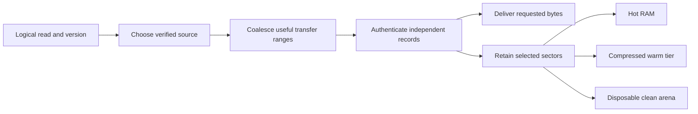

# MirageSSD: smaller residency, faster service, and the next research bets

Research date: 2026-10-12. Repository base: `4402660a21b764cfaad901d6955a435231ca9ed3`.
This continues the Devin conversation **Heavy optimizations and professional UX polish**.
The deliverables are four executable research harnesses and measured/model results;
production behavior has not been changed.

**Later result from the same investigation:** the
[verified encrypted seek prototype](2026-10-12-verified-encrypted-seek.md)
demonstrates smaller authenticated reads from the existing ciphertext using
proofs to the existing plaintext BLAKE3 root. It supersedes this report's initial
assumption that reducing authenticated transfer size requires new AEAD records.
It also demonstrates retaining and refining proof metadata after data eviction.
The measurements below remain valid within their stated scopes.

The strongest direction is to make **verification, transfer, retention, and remote
object packing independent decisions**, then choose retention according to the
cost of obtaining the bytes again. A single 4 MiB unit currently controls too much.
For some workloads, reducing that coupling can save far more space than a cleverer
replacement policy. For others, changing the source of a miss matters more than
any cache algorithm.

There are also two concrete implementation costs to remove immediately: an extra
serialized 68-byte network request, and full-frame copying on warm reads. These
are repairable inefficiencies, not new scientific discoveries. The research
opportunity is the system built after removing them.

## 1. What the evidence actually establishes

### Results produced in this investigation

Machine: Intel Core i5-1135G7, 4 cores / 8 logical processors, approximately
11.65 GiB visible RAM, Windows 11 Home 10.0.26300, Rust 1.94.0, Python 3.10.10.
The final warm-hit run was run separately from the cache-policy simulation.
This is a single general-purpose host, without CPU isolation.

| Experiment | Result | Interpretation |
|---|---|---|
| Actual range scheduler with a 60 ms-per-request mock backend | Current median **125.72 ms**; balanced partition **64.58 ms** | Proves an avoidable second request wave, with exact byte assembly. It does not measure live Drive latency. |
| Warm 4 KiB read from a cached 4 MiB frame, source-inspired harness | Thread + full `Vec` clone: **1,073.65 us** median; inline shared `Arc` slice: **0.45 us** | Identifies removable local work. It excludes the rest of the filesystem and cannot be used as an end-to-end speedup ratio. |
| 105 synthetic trace/seed/capacity combinations, six policies | Clear-all loses to simple alternatives on several traces; every policy has bad cases | Replace clear-all, then evaluate policy selection on real traces. |
| Independent 64 KiB zlib-1 blocks, bounded real local samples | Source retained **30.95%**; installed binaries **47.22%**; random control **100%** with raw fallback | Compression is worth testing as an optional tier for suitable bytes. These are not game-archive or whole-drive savings. |

The scheduler harness extracts `fetch_remote_range` verbatim from the current
source. It checks 71 range lengths per variant, exact returned bytes, continuous
coverage without gaps/overlap, and that the fifth request starts after the first
four complete. There are ten alternating-order timing pairs.

The warm-hit experiment separates the two costs instead of conflating them:

| Implementation pattern | Median of 8 per-round p50s | Median of 8 per-round p99s |
|---|---:|---:|
| Spawn thread, clone 4 MiB, return 4 KiB | 1,073.65 us | 3,071.35 us |
| Inline, clone 4 MiB, return 4 KiB | 1,010.95 us | 2,737.35 us |
| Spawn thread, share frame, copy 4 KiB | 77.70 us | 244.30 us |
| Inline, share frame, copy 4 KiB | 0.45 us | 1.20 us |

Each variant performs 8,000 reads across eight frames; execution position rotates
between rounds. Every returned byte is checked, and all checksums agree. The
allocation/copy cost dominates this fixture, with thread creation adding a
separate cost. Contended callbacks, misses, database lookup, decryption, WinFsp,
and kernel transitions are absent. In particular, this does not explain all of
the previously observed 103 ms mounted warm-read time.

Durable results, source hashes, and methodology labels are in
[`cache-research-2026-10-12.json`](cache-research-2026-10-12.json).
Full regenerated outputs belong under `target/perf/research-20261012/`.

### What remains useful from Devin's interrupted run

The saved mounted probe reported a 3,633 ms median for twelve nominally cold
4 KiB reads, 103 ms for repeated reads, and 2.4 MiB/s for a 96 MiB sequential
read. This establishes a serious performance problem in that session. It does
not isolate its cause: the timer includes opening/closing the file, residency
was not independently verified, and `buffering=0` bypasses Python buffering,
not Windows' cache.

An earlier interpretation needs correcting: **8,153 MiB and 12,203 MiB were
changes in D: free space, not attributed measurements of Mirage cache growth**.
Background work and other processes can change that number. The restage path
below supplies a plausible mechanism for amplification, but it does not prove
that all those bytes came from the twelve reads.

The saved direct-Drive probe found approximately 2 seconds to response headers
for both 64 KiB and 4 MiB warm-connection requests. Its `ttfb` label measures
`send()` completion rather than the first payload byte. More concurrency raised
aggregate throughput in that run. HTTP/1 and HTTP/2 used different, sequential
sample groups, so their difference does not establish a protocol advantage.
The one-request 16 MiB cases each have n=1. Those results motivate paired
experiments; they are not stable provider guarantees.

Google documents range downloads for blob files, but not a low-latency guarantee
for them. [Drive download contract](https://developers.google.com/workspace/drive/api/guides/manage-downloads).

## 2. Concrete costs found in the implementation

| Location | Observation | Engineering consequence |
|---|---|---|
| `crates/mirage-ffi/src/publisher.rs`, `payload_frame_range` / `fetch_remote_range` | A full frame is 4 MiB plaintext plus 68 encoded bytes. Splitting at 1 MiB produces five requests, scheduled four at a time. | The final 68 bytes incur another request wave before the frame can authenticate. Test four balanced pieces, one request, and a small-tail merge under real backend limits. |
| Same file, `frame` and `read_inner` | A cache hit clones the complete `Vec<u8>` while holding the frame-cache mutex. `read_inner` creates scoped threads even for hits. | Return shared immutable frame ownership; slice/copy only requested bytes; check hits before scheduling miss work. |
| Same file, frame admission | Crossing the 128 MiB budget clears the entire frame cache. At full-size geometry it holds only 32 frames. | Incremental eviction and admission filtering can preserve useful residents instead of periodic complete loss. |
| `crates/mirage-ffi/src/write.rs`, `restage_evicted_payload` | Only a coarse budget precheck precedes downloading the entire payload. Exact byte admission and disk-floor checks occur after `fetch_whole`. | Reserve the exact prospective allocation before fetching; rejected work should not consume network, decryption, and large temporary buffers. |
| Same file, `schedule_restage_with_lookahead` | A remote read schedules its whole payload plus up to two subsequent payloads when the ledger has headroom. The function does not establish that this reader is sequential. | Sparse/header reads can trigger large unrelated transfers and disk retention. Infer sequential behavior before lookahead and give it an explicit byte/time budget. |
| Same file, restage publication | Clean downloaded payloads return to the journal and its dirty-byte accounting. | Separate durable unuploaded writes from disposable clean residency. Read caching should not contend with writes through an undifferentiated ledger. |
| `crates/mirage-db/src/payload_remote.rs`, `published_payloads_evictable` | Eviction candidates are ordered by publication time. | Publication age is not access value. Track demand reuse and miss cost independently. |
| `publisher.rs`, `fetch_remote_part`; Drive `backend.rs` | Range fetches pass `BlockingRead`, including restage work; the backend ignores `_class`. | Priority labels alone cannot protect demand reads. Enforce priority in an actual shared queue with global request and byte limits. |
| Drive `native_http.rs` and `read.rs` | The transport collects the complete response body, then exposes an in-memory `BackendByteStream`. | Coalescing into larger requests alone delays first delivery. A genuinely streaming response path is needed for early microframe completion. |
| `native/winfsp-adapter/src/service.cpp` | Writable mounts deliberately avoid the kernel data-cache path following a cached-write deadlock issue. | A read-only immutable presentation deserves a separate performance experiment. Blindly toggling writable caching can reintroduce the original failure. |

New writable segments are 32 MiB (`segments.rs`). A current-payload-plus-two
lookahead can therefore request 96 MiB for one disjoint trigger when eligible.
Deduplication, queue limits, residency, payload history, and budget checks affect
what actually runs. This arithmetic is not an attribution of the free-space
changes above.

Existing defenses matter: frame single-flight, a bounded restage worker pool,
cached file handles, read database pooling, immutable-engine reservations, and
capsule baselines already exist. The gap is uneven integration and the work
granularity, not the absence of all caching or scheduling machinery.

The fastest useful implementation sequence is: fix the request tail; share warm
frames; replace clear-all; reserve before restage; then decouple clean residency
from the journal. Each step is independently measurable and makes the later
architecture easier to evaluate.

## 3. The main research direction: four independent granularities

Today, requesting a few bytes can drag a large verification unit, a larger
payload, and background disk materialization behind it. The proposed design
gives each decision its own unit:

| Decision | Initial experimental choices | Why |
|---|---|---|
| Verify/decrypt | 64 KiB, 256 KiB, 1 MiB independent records | Bound the bytes required before an exact small read can complete. |
| Transfer | One record through several MiB, chosen by locality, source latency, and deadline | Amortize high request latency without forcing the same amount of retention. |
| Retain | Touched 4/64 KiB sectors, optionally compressed; temporary full frames during active use | Charge the cache for useful bytes and measured reuse rather than every downloaded neighbor. |
| Pack/upload | Existing payload/object packing or larger bounded packs | Keep provider object counts and publication overhead independent of read granularity. |



### Existing-format experiment first: fetch once, keep less

Fetch and authenticate the existing 4 MiB frame, serve the request, then retain
only the sectors with evidence of reuse. Keeping one 64 KiB sector retains
**1/64 of the plaintext, a 98.4375% reduction** relative to keeping that full
frame. This is exact geometry for that access shape, before metadata and
allocation overhead. It is not a predicted whole-drive reduction.

The first network fetch remains 4 MiB when no proof catalog exists. Without
retained proof metadata, later reads to discarded neighboring sectors can require
another full-frame download. The follow-up prototype removes that repeat penalty
for proved sectors by retaining a small verification witness. Keep a short-lived
full frame while requests are arriving, promote dense-use frames, and compare
saved residency against extra bytes and stalls. A per-frame 64-bit touched map
is a compact signal, but payload IDs, ownership, indexing, and allocation need
accounting too.

Persisted sectors need a trustworthy association with the verified content and
its exact generation. A local derived checksum can detect accidental damage;
it does not magically become a remote sub-frame authenticity proof. The durable
trust model must explicitly cover the sector index and bytes.

### New-format experiment: fetch less as well

Independently authenticated records make small cold transfers possible. Pack
many records into a single provider object, retain authenticated offsets and
lengths, and coalesce neighboring requests while decoding records as their
complete ciphertext arrives. Bind repository, object identity, record index,
plaintext length/hash, and version into authentication. Compression, if used,
must also have independently decodable units.

| Plaintext verification unit | Aligned 4 KiB cold-read amplification | Retention for 4,096 distinct headers | 68-byte envelope overhead | Flat 32-byte hashes per TiB |
|---:|---:|---:|---:|---:|
| 64 KiB | 16x | 256 MiB | 0.104% | 512 MiB |
| 256 KiB | 64x | 1 GiB | 0.026% | 128 MiB |
| 1 MiB | 256x | 4 GiB | 0.0065% | 32 MiB |
| 4 MiB | 1,024x | 16 GiB | 0.0016% | 8 MiB |

These are geometry calculations for independent units, not measurements of the
existing immutable pack format. That format has roughly 4.4 KiB of overhead per
page in the earlier fixture, substantially more than the writable encrypted
record's 68 bytes. Its [existing page-geometry experiments](page-geometry-2026-09-14.md)
also show that physical allocation and coalescing determine sequential speed.
They already reached approximately 0.81-0.87 ms per sequential 1 MiB read across
page sizes after batching. That achievement should be reused.

The current publication metadata implies 4 MiB frame geometry. Changing a
constant would break old offsets and hashes. New records require explicit
representation/version metadata and dual-format reads. Merkle proofs can reduce
the need for a fully resident flat hash table, but their storage, proof-fetch,
root-trust, and verification costs must be measured. Bao provides verified
streaming/range mechanisms. The later prototype shows that XChaCha20's payload
can be decrypted at an offset and the resulting selected plaintext verified
against Mirage's existing BLAKE3 root. It does not partially verify the old
AEAD tag; it supplies a different authentication path with the same trusted
content root. The initial claim that the existing frame could not support this
was too strong. See the [follow-up](2026-10-12-verified-encrypted-seek.md) and
[Bao design](https://github.com/oconnor663/bao).

This direction is an integration hypothesis, with substantial prior art in
partial-block caching and independently verifiable representations. Its value
would be a demonstrated improvement on Mirage's Windows workloads, not a claim
that small blocks or streaming were newly invented.

## 4. A cache should buy avoided stalls, not maximize its hit counter

A 64 KiB region available from a fast local origin and another requiring a
two-second cloud request have the same size but very different eviction costs.
Likewise, a prefetched hit delivered after the application stalled is less
valuable than a timely hit. The research objective should be **critical-path
stall avoided per allocated byte**, with explicit penalties for speculative
traffic, CPU, and interference with foreground work.

One candidate admission score is:

```text
value(i) = [P(reuse within horizon) * expected exposed stall if absent
            - expected speculation/queue/CPU penalty] / allocated bytes(i)
```

This is a hypothesis for evaluation, not a complete controller. Concurrent
dependencies make exposed stall non-additive; observed service time alone
cannot identify the application's critical path. Start with conservative
measurable proxies, compare them against actual application completion time,
and retain offline/pinned requirements as constraints outside the score.

Cost-and-size-aware caching already has a long history in
[GreedyDual-Size](https://www.usenix.org/conference/usits-97/cost-aware-www-proxy-caching-algorithms).
[Baleen](https://www.usenix.org/conference/fast24/presentation/wong) jointly learns
admission/prefetching to optimize backend work. Mirage's interesting question is
how source latency, verification geometry, and launch deadlines change the best
use of a small Windows cache.

### The policy experiment, including the failed clever idea

The model uses identical fixed-frame payload capacity, seven traces, five seeds,
and capacities of 16, 32, and 64 frames. Table entries are mean miss percentages
over the five seeds at 32 frames, equivalent to 128 MiB at current geometry.

| Trace | Clear-all | LRU | MRU | SIEVE | Online periodic predictor | Future-aware oracle |
|---|---:|---:|---:|---:|---:|---:|
| Hot set interrupted by scans | 31.54 | 28.95 | 69.23 | **21.18** | 28.95 | 21.18 |
| Hot set with interleaved one-hit objects | 26.67 | **20.05** | 91.85 | **20.05** | 25.99 | 20.05 |
| Repeating 33-frame cycle | 100.00 | 100.00 | **3.36** | 100.00 | 3.85 | 3.36 |
| Single scan | 100.00 | 100.00 | 100.00 | 100.00 | 100.00 | 100.00 |
| Uniform random over 256 frames | 93.50 | **87.74** | **87.74** | 87.80 | 87.76 | 57.79 |
| Changing hot sets | 2.07 | **1.60** | 80.46 | 3.19 | **1.60** | 1.60 |
| Four reads per new item | 25.00 | 25.00 | 25.00 | 25.00 | 25.00 | 25.00 |

The periodic predictor estimates request-index recurrence with an exponentially
weighted interval/deviation history. It uses only past accesses and a bounded
history of four times the cache capacity. Initially its 3.85% cyclic miss rate
looked impressive against LRU's 100%; adding MRU falsified that impression.
**The new predictor did not justify its complexity.** MRU's catastrophic results
on other traces also rule out adopting it globally.

SIEVE helps the scan mixture, but loses to LRU after phase changes. Uniform
random access offers little learnable locality. The oracle sees future requests
and is a fixed-size, mandatory-insertion miss-count lower bound, not a deployable
algorithm. Bypass/admission policies need their own matching oracle convention.
Policy metadata, CPU, compression, variable-size records, prefetching, and source
costs are excluded from this replay; the predictor's ghost history is not free.

The next experiment should combine bounded shadow-policy estimates and phase
signals to select among simple policies, with hysteresis and a stable fallback.
It must beat LRU, MRU, SIEVE, S3-FIFO, ARC/2Q, and a simple sequential bypass
policy at equal **total** resources on held-out traces before earning a complex
model. The current replay implements only the six table columns.

[SIEVE](https://www.usenix.org/publications/loginonline/sieve-cache-eviction-can-be-simple-effective-and-scalable)
and [S3-FIFO](https://github.com/Thesys-lab/sosp23-s3fifo) supply strong simple
baselines. Adaptive mixtures also predate this work, including
[LeCaR](https://www.usenix.org/conference/hotstorage18/presentation/vietri).
Learning should run outside the read critical path; recent
[3LCache](https://www.usenix.org/conference/fast25/presentation/zhou-wenbin)
still reports CPU overhead relative to LRU despite major learning-efficiency
improvements.

## 5. Separate dirty durability, clean residency, and in-flight memory

The current clean-restage/journal coupling makes a cache optimization consume a
resource also needed for writes. The proposed ownership model has three explicit
budgets:

1. **Dirty journal:** the authoritative local bytes until publication is durable;
   reserve before accepting writes, and release only according to the existing
   publication/recovery contract.
2. **Clean cache:** reconstructible authenticated sectors; bounded RAM and disk
   tiers with independent admission and eviction. Reuse existing cache and
   manifest machinery where their lifetime contracts fit.
3. **In-flight work:** response buffers, decrypted frames, decompression buffers,
   shared results still held by readers, and queued reservations. Charge the
   allocation until its final owner releases it.

Replacing a `Vec` with an `Arc` removes copies; evicting an `Arc` from a map does
not free bytes still held by readers. Otherwise a nominal 128 MiB cache can hide
a much larger working set. A global allocator/reservation view must span all
readers and background tasks, not multiply a per-request concurrency cap by an
unbounded number of callers.

Demand misses should take priority over predicted reads, which should take
priority over restage/maintenance. Coalesce shared work, and cancel speculative
work that no longer has a useful subscriber. Avoid treating the backend's
ignored priority parameter as implemented scheduling.

The immutable mounted-generation cache already excludes reclaim while a
generation is mounted. Its future cross-process reader leases are a separate
problem from an in-process shared-frame cache. Any sector-arena design must
preserve the applicable [slot lifetime contract](../specs/slot-lifetime-v1.md)
instead of assuming that a generation check prevents reuse during a read.

### Optional compressed warm tier

At 64 KiB block size, the measured zlib-1 samples retained 30.95% of approximately
4.00 MiB of repository source and 47.22% of 16 MiB of installed executables.
Decode plus byte comparison was approximately 195 and 182 MiB/s respectively.
The seeded 8 MiB random control retained 100% through raw fallback. Codec flags,
indices, allocator slack, encryption envelopes, and disk allocation are excluded.

Compression therefore deserves a targeted experiment for cold-but-reused
plaintext, with a minimum saving threshold and a CPU budget. Keep very hot bytes
uncompressed; demote suitable bytes into a compressed tier; bypass compression
for measured incompressible data. Avoid copying the same plaintext into every
tier. Benchmark LZ4 and Zstandard independently; a zlib result does not estimate
their speed or ratio. Already compressed media and ciphertext need representative
samples before any capacity claim.

Exact fixed-block deduplication found **zero duplicate-byte savings** in these
small corpora. That weakens a generic dedup pitch; it does not evaluate
cross-version game updates or content-defined chunking. Those need version-pair
corpora and reference-lifetime accounting.

Compressed caching is established prior art, including
[Linux zswap](https://www.kernel.org/doc/html/latest/admin-guide/mm/zswap.html).
The possible Mirage gain is selecting the right tier under real application
memory pressure, rather than moving pressure from disk into RAM and calling it
a reduction.

## 6. The more radical bet: cache a byte's identity and supply options

Mirage could represent a file as an exact, version-bound byte recipe with several
possible sources: existing immutable local content, an opted-in nearby device,
a publisher-provided origin, and the encrypted archive. Source selection would
use observed latency, throughput, availability, and verification cost. A local
cache entry would then mean "pay to retain these bytes because recreating them
is expensive," rather than "keep a copy because the file lives in Drive."

This is particularly attractive for a large immutable public installation with a
small private write overlay. Publisher bytes can come from a supported source;
private changes still use the private archive. Exact content identity, not a
matching path or filename, determines interchangeability. Revoked/expired source
access and changed content must invalidate the option without corrupting the
logical file.

This design can change the cache-size/latency frontier more than replacement
policies: reducing a miss from two seconds to tens of milliseconds sharply
reduces the useful predictive lead and the cost of eviction. It remains
conditional on a real faster source. Moving a complete copy to a second folder
on the same machine does not reduce total local storage and must be counted.

The underlying ideas are established. [CASPER](https://www.usenix.org/legacy/events/usenix2003/tech/full_papers/tolia/tolia_html/usenix03.html)
used content-based recipes and alternative local sources. Google's
[CDC file transfer](https://github.com/google/cdc-file-transfer) includes game
development file streaming and content-defined synchronization; the repository
was archived in 2025. Neither should be marketed as a new Mirage invention.

The contribution worth pursuing is their combination with small verified
residency, a supported Windows presentation, private writable overlays, measured
source selection, and explicit readiness. This builds on the repository's
[continuum proposal](../proposals/2026-09-continuum-architecture.md) and
[backend contract](../specs/backend-contract.md), rather than replacing them with
a second disconnected architecture.

### Pack startup dependencies together

Small metadata/index/header reads may form a chain of dependencies: fetch A to
discover B, then B to discover C. Increasing parallelism cannot eliminate a
serial chain whose next address is unknown. For repeatable launches, collect
the actual dependency working set and publish a small contiguous launch pack
whose contents arrive early in one streaming transfer. Main data stays in the
archive. In the ideal latency-dominated case, shortening a chain of d requests
can save roughly `(d - 1) * source_latency`; real benefit depends on overlap,
size, and profile accuracy.

The repository already has capsules, readiness compilation, version binding,
and equal-budget predictive baselines. The missing experiment is a real launch
trace and end-to-end integration, not a new name for prefetching. FAST 2026's
[PPC/MAIO](https://www.usenix.org/conference/fast26/presentation/liu-yubo) is useful
recent evidence for workload I/O templates, in the different setting of model
loading. Its published improvements are not Mirage estimates.

## 7. Physical limits that determine which wild ideas are useful

For sustained consumption at rate R and replenishment latency L, a rough
minimum predictive lead is `W = R * L`, with sustainable backend goodput at
least R. Treat this as an idealized planning relationship, not a hard guarantee
from average measurements; tail latency, outages, dependencies, and competition
increase the requirement.

| Consumer rate | Replenishment latency | Minimum ideal lead |
|---:|---:|---:|
| 32 MiB/s | 2 s | 64 MiB |
| 32 MiB/s | 200 ms | 6.4 MiB |
| 32 MiB/s | 40 ms | 1.28 MiB |

The lead can live in memory, an active transfer, or on disk. Count all of it.
A time-based window is better aligned with this requirement than "two payloads
ahead." Adaptation of prefetch windows has substantial prior art, including
[AMP](https://www.usenix.org/conference/fast-07/amp-adaptive-multi-stream-prefetching-shared-cache).

There is a separate write constraint. At 100 MiB/s incoming writes and 10 MiB/s
upload goodput, 60 seconds creates 5,400 MiB of unpublished backlog, before
overhead. A tiny durable write cache cannot sustain this indefinitely. Higher
upload goodput, genuinely compressible/deduplicated writes, a different durable
destination, or backpressure must pay that difference.

No predictor can make a uniformly random unseen request arrive beforehand with
certainty. No lossless codec can shrink every byte sequence. These limits steer
the search toward real structure: source alternatives, predictable phases,
duplicate versions, sparse access, and compressible data.

## 8. Unconventional hypotheses and the experiment that could kill each

| Hypothesis | Why it might work | Decisive counterexample or rejection criterion |
|---|---|---|
| **Keep only the control bytes.** Strongly favor measured headers, indexes, and serial dependencies; stream bulk data transiently. | A small dependency set may account for most exposed stalls. | A held-out launch has dispersed critical reads, or the profile costs more preparation/cache than a simple hot-set baseline. File extensions alone are inadequate evidence. |
| **Learn when to forget.** Evict consumed video/scan sectors quickly and preserve loop boundaries; use byte-range reuse distance rather than whole-file popularity. | One-pass bytes pollute small caches, while phase boundaries recur. | Backward seeks, replays, or multi-process readers cause more stall/refetch than a sequential-bypass baseline. |
| **Retain a small sector while briefly borrowing a big frame.** Keep full frames only during bursts, then split them into useful sectors. | Exploits short spatial locality without permanent full-frame retention. | Sector fan-out becomes dense, allocation/metadata dominates, or repeated legacy-frame fetches erase the benefit. |
| **Change representation with temperature.** Hot plaintext, warm independently compressed sectors, cold remote records. | Spend CPU only when it buys enough residency. | Decompression raises foreground p99, the application needs that RAM, or realistic data is already incompressible. |
| **Keep recipes for old versions.** Use content-defined chunks and exact delta reconstruction across version pairs. | Large updates may alter only a fraction of content; offset shifts need not destroy reuse. | Real title updates rewrite/encrypt nearly everything, retained bases outweigh savings, or reconstruction creates too much peak space/latency. |
| **Use a nearby device as a temporary extension of the cache.** A user-controlled LAN peer holds reconstructible content. | A fast miss source can replace substantial local residency. | Wi-Fi tails, sleeping devices, trust/identity overhead, or combined energy and bytes make local caching preferable. No always-on availability assumption. |
| **Regenerate instead of retrieve.** Cache deterministic inputs/checkpoints for user-owned generated assets, not all outputs. | Recomputing a small result may beat a WAN request. | Exact reproduction fails, the generator/version is unavailable, or recomputation CPU/energy/dependencies exceed retrieval. Arbitrary private files cannot be reconstructed from a guess. |
| **Place simple computation near the bytes.** For an opt-in search/preview API, return verified results or a smaller derived artifact. | Avoids transferring a full dataset merely to filter it. | The unmodified application requires raw bytes; encrypted content needs an unavailable trusted execution context; latency and operating cost exceed local work. This is a separate API, not transparent acceleration of arbitrary reads. |
| **Trade a little redundancy for lower tails.** Duplicate small high-value launch/control records across independent supported sources; hedge late requests. | Small extra storage can remove rare expensive stalls. | Sources share failures/bottlenecks, traffic amplification causes throttling, or measured tails do not improve at equal cost. |
| **Give immutable data a specialized presentation.** Benchmark an immutable read path with kernel caching separately from writable overlays. | Avoids paying writable-path restrictions for immutable content. | Update/coherency transitions, memory footprint, or compatibility erase the gain. CFAPI/ProjFS must earn selection through the existing capability gates. |
| **Borrow idle VRAM or remote RAM.** Explore only on machines with spare resources and an appropriate transport. | An unusual extra tier may absorb a large warm set. | Transfer/setup/driver overhead, game VRAM contention, or remote latency dominates. Shared system RAM on an integrated GPU supplies no independent capacity windfall. |

The last three broad memory ideas need application cooperation or a suitable
hardware/transport environment. [AIFM](https://www.usenix.org/conference/osdi20/presentation/ruan)
shows the value of application semantics for far memory, not that WAN storage
can behave like local RAM. [HyCache](https://www.usenix.org/conference/atc25/presentation/jha)
demonstrates choosing between recomputation and tiers for structured pipelines.
[uCache](https://www.usenix.org/conference/fast26/presentation/meignan-masson)
explores application-aware I/O caching in a unikernel; it is inspiration for
control boundaries, not a drop-in Windows backend.

Two directly comparable systems also deserve study before implementation:
[JuiceFS](https://juicefs.com/docs/community/guide/cache/) explicitly discusses
whole-block prefetch amplification after partial random reads, and
[rclone mount](https://rclone.org/commands/rclone_mount/) exposes chunked-read and
parallel-stream controls. Those mechanisms need comparison on the same source,
access trace, storage budget, and correctness checks. A much faster backend is
not evidence of a superior cache policy.

## 9. The experiments that could establish a substantial advance

Start with a corrected present-day baseline. Compare every architectural change
against the repaired scheduler/shared-frame/incremental-eviction implementation,
not just against current avoidable regressions. Otherwise the new architecture
will receive credit for an ordinary bug fix.

| Order | Experiment | Predeclared success target | What it decides |
|---:|---|---|---|
| 1 | Integrate balanced/merged tail scheduling and shared warm frames separately on a disposable mounted volume. | Eliminate the fifth request for a full frame; byte-exact results; reduced paired cold latency and warm CPU/copy costs without a p99 regression. | Size of the product gains from the two established mechanisms. The mock's near-2x improvement is not the target promised for Drive. |
| 2 | Compare automatic whole-payload restage, demand-only reads, and sequentially gated restage. | At least 80% less unrelated clean materialization on a sparse trace, without more than 5% regression in measured launch p95 or sequential throughput. | How much cache growth comes from policy rather than essential demand. Targets are research thresholds, not measured results. |
| 3 | Add legacy verified-sector retention; evaluate 64 KiB sectors and adaptive temporary full frames. | At least 90% less clean retention on genuinely sparse/header traces, no more than 10% extra backend bytes, and no more than 5% launch-p95 regression. | Whether reducing retention works before a format migration. Reject on dense-use traces instead of averaging the failure away. |
| 4 | Prototype independent 64/256 KiB records with streaming coalesced reads. | At least 16x fewer cold transferred bytes than the corrected 4 MiB baseline on sparse 4 KiB reads, while preserving at least 95% of its sequential throughput and bounded metadata/CPU. | Whether verification and transfer can be decoupled economically. Include cross-record and EOF reads. |
| 5 | Replay native launch/session/update traces at equal total resources; compare simple policies and selective compression. | A reproducible Pareto improvement: lower peak local allocation at equal application outcome, or lower stalls at equal allocation, across held-out versions and access patterns. | Which workload classes benefit and where the controller should abstain. |
| 6 | Measure source choice and a version-bound launch pack on a real supported content set. | Smaller total residency and fewer exposed launch/session stalls than the same cache using a single source, after including profile preparation, source-copy storage, and traffic. | Whether the system-level idea advances beyond local cache engineering. |

The percentage targets above are deliberately falsifiable hypotheses. Use a
preliminary variance study to choose enough paired trials; report confidence
intervals and failed runs. At minimum, use the same bytes, offsets, order,
concurrency, request class, security-software configuration, and settled
background activity. Alternate A/B order, distinguish process/OS/device cache
states, and verify every returned byte against known fixtures.

Report clean disk allocation, dirty backlog, physical RAM, retained shared
buffers, peak in-flight reservations, metadata, source duplicates, wire bytes,
requests/retries, CPU, and application outcome separately. File logical length
and filesystem free-space deltas are not substitutes for attributable physical
allocation. Cold/warm first-byte latency, complete-read latency, p95/p99, and
full launch/session time answer different questions.

### Trace data that is still missing

Existing `MIRAGE_FS_TRACE` aggregates callback/FFI counts and durations. It does
not supply the per-read sequence needed for realistic retention research.
Capture a bounded trace with monotonic request timestamps, pseudonymous file
and generation IDs, offset/length, demand/prefetch class, process/workload
category where available, tier hit/miss, transferred/retained bytes, and a shared
flight ID. Record queue, response-header, body-complete, authentication,
decompression, copy, and callback-complete timestamps. Include event-loss counts.

Collect launch, steady use, scene/level transition, scanning, update, backward
seek, and concurrent-reader sessions. Bind profiles to exact content and
configuration; split by session/version rather than randomly splitting requests
from one repeated run. Do not label a file extension or process name as proof of
criticality. Measure the application's completion and stalls alongside the I/O.

The repository already has the required conceptual gates in
[readiness-v1](../specs/readiness-v1.md),
[engine-api](../specs/engine-api.md), and
[capsule-v1](../specs/capsule-v1.md). Extend those contracts rather than reporting
a synthetic hit rate as application readiness.

## 10. Reproduction and implementation scope

From the repository root, using an already-installed compiler:

```powershell
python tools/perf/cache_research.py
python tools/perf/cache_compression_probe.py

# Choose the actual installed compiler path; avoid a rustup shim that installs
# a toolchain as a side effect. This is the path used on the research machine.
$taskRustc = 'rustc.exe'
python tools/perf/range_schedule_probe.py --rustc $taskRustc
& $taskRustc --edition=2024 -O tools/perf/frame_hit_probe.rs -o target/perf/research-20261012/frame_hit_probe.exe
if ($LASTEXITCODE -ne 0) { throw 'frame_hit_probe compilation failed' }
& ./target/perf/research-20261012/frame_hit_probe.exe |
    Set-Content -Encoding utf8 target/perf/research-20261012/frame-hit.json
if ($LASTEXITCODE -ne 0) { throw 'frame_hit_probe failed' }
```

Run timing experiments serially with other benchmarks/builds idle. The
compression corpus is a bounded, sorted sample of source and installed Mirage
executables, plus a seeded random control; changed inputs change the results.
The captured source sample predates this report. Input hashes identify what was
measured without storing source or user-file contents in the results.

The harnesses write only under the chosen result directory and read local
source/sample files. The range and warm-hit experiments make no backend network
requests and do not mount, evict, or modify a Mirage volume. The full workspace,
WinFsp mounted-volume, and desktop-UI checks were not run because this change
adds research files rather than production behavior. They remain required when
the corresponding production implementation is changed; adapter/FFI changes
also require the rebuilt debug native adapter.

## Research decision

Pursue **small verified residency with independent transfer geometry and
source-aware admission**, using the existing readiness/capsule architecture.
Begin with the two demonstrated local mechanisms, then the clean-cache/journal
split and legacy-sector experiment. Treat new-format microframes and source
recipes as the higher-upside branch of the research.

There is no demonstrated universal or world-class breakthrough yet. There is
now concrete evidence of avoidable work, an exact conditional 64x retention
opportunity, a failed predictor hypothesis, and a testable system design. A
strong breakthrough claim would require beating corrected implementations and
simple prior-art policies on real held-out workloads, at the same complete
resource budget, with repeatable application gains.
