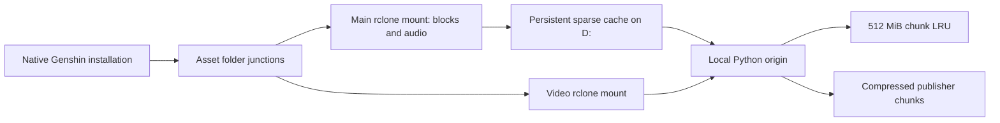

# Genshin runtime audit and lag fixes

2026-10-12. This records the actual machine setup and changes made while
investigating reported lag, long delays, and getting stuck. It is not a measured
gameplay or frame-time certification.

## What currently serves the game

The current game root is `game-root`.
Its executable and ordinary installation files are native. Three asset trees
are junctions into GenshinStream:

| Game tree | Actual path |
|---|---|
| `StreamingAssets\AssetBundles\blocks` | `stream-root\mnt`, rclone full VFS cache |
| `StreamingAssets\AudioAssets` | Same main mount |
| `StreamingAssets\VideoAssets` | `stream-root\mnt-video`, rclone cache off |

Both mounts use a Python HTTP origin on `127.0.0.1:18765`. It fetches compressed
Sophon chunks from the configured publisher CDN, decompresses them, checks their
length and manifest MD5, then serves requested plaintext ranges. It has a
512 MiB decompressed-memory LRU. The current configuration has no local seeds.

The installed MirageSSD 0.1.19 service also has a separate Drive-backed `G:`
volume, but the three current game junctions point to GenshinStream. Earlier
release notes about keeping gameplay data native and only selected media on
Mirage do not describe this newer layout. In this layout, gameplay blocks also
depend on online misses.

The installed CLI reports build `003505079a23-dirty`; the research checkout is
a different revision. Findings about the live stream helper were confirmed in
its actual source and running configuration rather than inferred from the
workspace build.

## Confirmed problems and changes

### 1. The persistent cache was being discarded

The live main mount had `--vfs-cache-max-size 30G` and
`--vfs-cache-min-free-space 30G`, while D: had approximately 6-8 GiB free.
Its log showed repeated removal of cached assets and a cleanup down to zero
objects. A recent-read report found 822 distinct files and approximately
4.37 GiB of successful served ranges, but no persistent cache remaining.

This forced repeat reads back through the chunk/CDN path. The source log
contained request durations up to 17.3 seconds in the observed window. These
are origin-response timings; their attribution to application frame stalls
was not instrumented.

Changed the startup settings to a **6 GiB cache target and 2 GiB free-space
floor**, backed up the old script, and restarted only the verified main mount
while the game was not running. The mount listing checks completed. The video
mount was retained.

The rclone documentation describes the free-space target and explains that
open files and periodic cleanup make these limits soft:
[rclone VFS cache behavior](https://rclone.org/commands/rclone_mount/#vfs-file-caching).
Cache warming separately stops before another read when D: free space falls
below 3 GiB. Other processes can still change disk availability.

The startup script's old recursive removal of a mountpoint was also replaced
with a nonrecursive directory/reparse-entry removal. An unexpected nonempty
ordinary directory will fail rather than be recursively erased.

### 2. Speculative work could starve urgent reads

The original origin submitted demand and prefetch work to the same 32-worker
executor. Prefetch acquired its four-slot semaphore **inside a worker**. A
large speculative backlog could therefore occupy every worker, leaving demand
queued even though network capacity remained. The small prefetch semaphore did
not establish foreground priority.

Changed the actual origin helper to:

- Run background prefetch on a separate four-worker executor.
- Acquire bounded prefetch admission before enqueueing, without waiting. Busy
  speculative slots cause excess work to be skipped.
- Release admission through a completion callback, including cancellation.
- Permit immediate completion callbacks to release a flight without recursively
  deadlocking its lock.
- Avoid canceling shared chunk futures when another reader's response fails.
- Count actual admitted prefetch jobs rather than potential lookahead entries.

The existing chunk length/MD5 checks and exact-byte serving remain in place.
The origin was restarted from the modified file and its stats endpoint and
mounted reads succeeded.

## Verification

A regression probe imported both the preserved original helper and the fixed
helper, with a controlled chunk source:

| Concurrent scenario | Original | Fixed |
|---|---:|---:|
| Prefetch jobs admitted after 64 eight-chunk triggers | 512 | 4 |
| Urgent read completes while prefetch is blocked | No, exceeded 750 ms probe timeout | Yes, approximately 0.43 ms in this fixture |

This demonstrates worker isolation, not a 0.43 ms network or gameplay promise.
The fixed helper also passed 32 exact-byte range cases, immediate-callback
cleanup, and cancellation/admission cleanup checks.

An actual mounted probe opened, sought, read, and closed 64 KiB ranges from three
recently accessed Genshin `.blk` files. All returned bytes matched the local
origin's chunk-verified output. Initial mounted reads took approximately
106-241 ms, and repeated-read medians were **6.48-6.91 ms**. The origin-reference
reads had already warmed some chunk data, so the initial numbers are not a clean
cold-CDN benchmark. Warm reads may also benefit from Windows caching.

A later check, 115 seconds after the first probe, returned the same bytes in
**7.52-9.13 ms** with **zero additional CDN chunks**. Cache-cleaner log entries
confirmed the data remained stored instead of being purged. These checks do not
measure FPS, long-session stutter, or every possible asset.

Recent successful source ranges were used for bounded preparation through
the game junctions. The preparation plan covered 822 files and 4,692,321,094
distinct bytes with two workers, a 4.5 GiB requested-byte ceiling, and a 3 GiB
pre-read free-space check. These source ranges include transport read-ahead;
they are not an exact application-demand trace. Preparation completed 391 whole
file jobs and read **3,383,493,058 bytes (3.15 GiB)**, with zero read errors,
then stopped at its free-space guard. It took approximately 306 seconds.
The rclone cleanup log reported approximately **5.17 GiB retained**, greater than
the requested-byte count because buffering and range fetching can materialize
extra data. This is another reason not to equate demanded bytes with actual
cache footprint. The final result is recorded in
`target/perf/genshin-fix-20261012/warm-recent.json`.

Live-source backups and rollback inputs:

- `stream-root\run\start-genshinstream.before-cache-fix-20261012.ps1`
- `stream-root\run\sophon_origin.before-lag-fix-20261012.py`

Raw probes are under `target/perf/genshin-fix-20261012/`. The durable evidence
summary is [`genshin-lag-fix-2026-10-12.json`](genshin-lag-fix-2026-10-12.json).

## How the proposed Mirage architecture applies

The [verified encrypted seek prototype](2026-10-12-verified-encrypted-seek.md)
works on Mirage's `MENCv001` objects, using an existing trusted BLAKE3 plaintext
root and length. **The current GenshinStream path does not use that format.**
The 939x response-size reduction measured there cannot be assigned to this
publisher-chunk path.

Sophon chunks are compressed. A small requested plaintext range can still
require downloading and decoding its whole compressed chunk; adding a plaintext
proof does not remove that compression dependency. Verified seeking becomes
directly applicable if content is placed into Mirage's compatible representation
with proof catalogs, or if an independently seekable source representation is
available. Its bootstrap and publication costs must then be included.

The architecture principles do apply immediately: retain useful verified bytes,
keep foreground work separate from speculative work, charge persistent and
temporary residency, prepare known access patterns, and bind caches to exact
content/build identity. The fixes above address two concrete violations of
those principles in the live Genshin helper.

Future qualification must include cache-miss latency during real gameplay,
first visits, language/configuration changes, video behavior, updates and repair,
and peak disk/RAM use. The no-cache video path and cold unseen chunks can still
cause waits. The fixes do not establish offline readiness or zero stalls.

## Where Winds Meet removal status

The user requested complete removal. The installation was positively identified
by its registered NetEase launcher and `setting.ini`:

- Launcher: `launcher-root`
- Game: `removed-game-root`, with `Engine\Binaries\Win64r\wwm.exe`
- Game footprint observed: 145,516,363,188 logical bytes, approximately 135.5 GiB.
  A per-file physical-allocation query returned the same sum; shared hardlinks,
  if any, could still change exactly how much an uninstall recovers.
- Installer: `launcher-installer`

The game root and descendants were checked for reparse points; none were found,
and no running `wwm.exe` was found. Automatic command review nevertheless
rejected direct recursive removal, stating only `blocked by policy`.
Removal of the positively identified installer file was also rejected with the
same reason. It remains present.

The signed NetEase official uninstaller was then launched through Windows
elevation. Windows reported `The operation was canceled by the user`. The game
and launcher directories still existed afterward. **Removal has not completed,
and no recovered-space claim is made.** Completing removal requires the official
Windows uninstall interaction or another approved removal route; elevation was
not bypassed.
